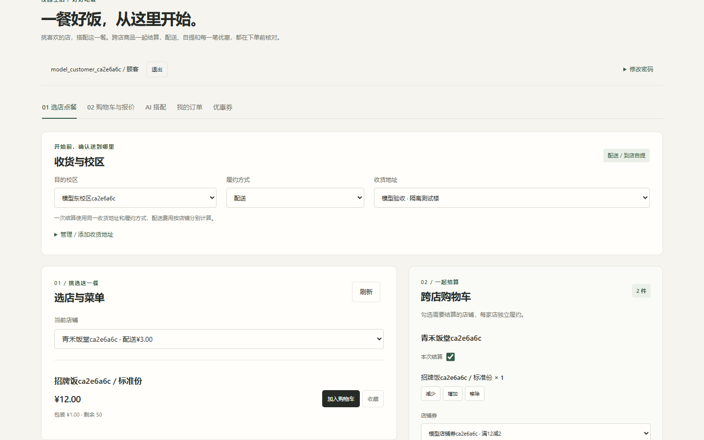
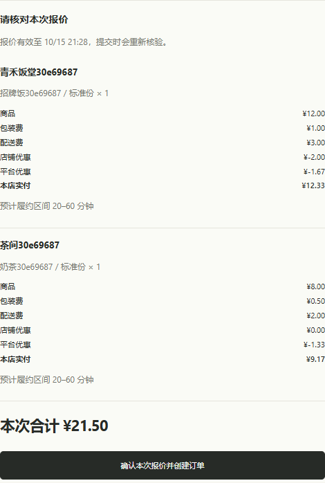
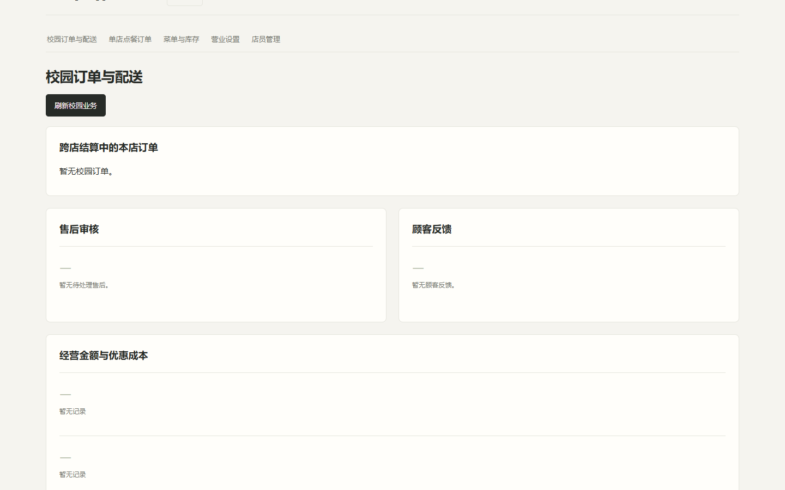
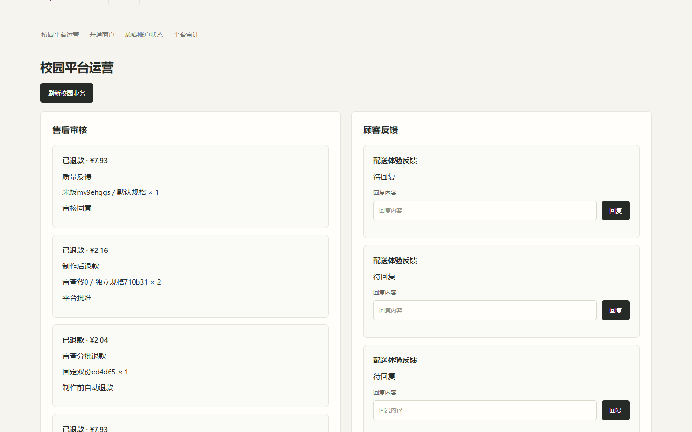

# AI 点餐助手

[](https://github.com/W205614/AI-Order-Assistant/actions/workflows/ci.yml)
[](https://github.com/W205614/AI-Order-Assistant/actions/workflows/security.yml)

一个可本地部署的校园多店点餐演示系统。顾客可以直接选菜，也可以让 AI 按口味和预算推荐、准备跨店购物车；核对报价后统一结算，再由各店独立备餐、配送或自提。

项目采用 **Java 业务后端 + Python Agent**：Java 核验权限、价格、库存和订单，AI 负责理解需求与调用工具。创建订单和模拟支付都需要顾客在页面确认。**支付、退款均为模拟，不涉及真实资金。**

[快速开始](#快速开始) · [项目结构](#项目结构) · [体验第一笔订单](#体验第一笔订单) · [稳定性与日常维护](#稳定性与日常维护) · [页面预览](#页面预览) · [更多文档](#更多文档)

## 功能与解决的问题

| 场景 | 提供的功能 |
|---|---|
| 不知道吃什么、想控制预算 | AI 按口味和预算搜索、推荐并准备购物车；也可不依赖模型，使用页面的预算组合查询 |
| 多家店分开下单、费用难核对 | 跨店购物车、统一报价与结算，逐店展示商品、包装费、配送费及优惠 |
| 有忌口或过敏需求 | 饮食偏好供推荐参考；过敏约束逐店确认，由后端过滤并校验可售商品 |
| 点餐后的履约与售后 | 配送或到店自提、预约、店铺券与平台券、按数量退款、收藏与复购 |
| 商家与平台协作 | 商家管理菜单、规格库存、订单及售后；平台管理校区、商户、优惠和骑手，支持抢单与人工派单 |

技术栈：Spring Boot、Spring Security、MySQL、Redis、FastAPI、LangGraph；前端使用原生 HTML/CSS/JavaScript，通过 Docker Compose 部署。

## 项目结构

```text
AI-Order-Assistant/
├── java-gateway/       # Java 业务后端、静态前端、数据库迁移与 Java 测试
├── agent-service/      # Python Agent、工具、FAQ、单元测试与模型评测
├── deploy/             # Compose 场景覆盖、代理、监控与按需启用的备份配置
├── scripts/            # 初始化、运维、检查与端到端验证脚本
├── load/               # k6 压测场景；输出写入忽略的 results/
├── docs/               # 源码阅读指南、业务规则、运维说明与页面截图
├── .github/            # CI、安全扫描与手动模型评测工作流
├── .env.example        # 配置模板；私密值写入本地 .env
├── docker-compose.yml  # 完整应用的统一部署配置
└── start.ps1/start.bat # Windows 启动入口
```

初次使用先完成下方快速开始；想读源码时，从 [项目结构与阅读顺序](docs/project-structure.md) 开始。前端位于 Java 的 `src/main/resources/static/`，没有独立 Node 前端项目。脚本按用途查阅 [脚本索引](scripts/README.md)。

## 快速开始

### 1. 准备环境

- 安装 Git、Docker 和 Docker Compose。Windows 推荐使用 Docker Desktop，并切换到 Linux 容器。
- 启动 Docker，确保本机 `9090`（应用）和 `19091`（监控）端口未被占用。
- 首次构建需要联网下载镜像与依赖；使用 Docker 部署无需在本机安装 Java、Python 或 MySQL。

### 2. 下载并启动

在 Windows PowerShell 中运行：

```powershell
git clone https://github.com/W205614/AI-Order-Assistant.git
cd AI-Order-Assistant
.\start.ps1 -Build
```

脚本自动生成本地 `.env`、初始化数据库并启动服务，保留已有配置。日常默认启动 Java、Agent、MySQL、Redis 和 Prometheus 五个服务。没有本机停用标记时，Windows 启动脚本仍会在启动应用前执行一次数据库备份；存在 `backups/.backup-disabled` 时跳过这次备份。后台每日备份需显式启用 `manual-backup` profile，详见 [备份策略](docs/operations.md#备份恢复与清理)。看到 `Ready: http://localhost:9090/` 后，打开 [校园点餐页面](http://localhost:9090/campus/)。首次构建耗时取决于网络和机器性能。

如果 PowerShell 提示禁止运行脚本，可仅对本次启动使用：

```powershell
powershell -NoProfile -ExecutionPolicy Bypass -File .\start.ps1 -Build
```

<details>
<summary>Linux / macOS：全新部署</summary>

```bash
git clone https://github.com/W205614/AI-Order-Assistant.git
cd AI-Order-Assistant
cp .env.example .env
# 先按下方说明编辑 .env，再启动
docker compose -p ai-order-assistant -f docker-compose.yml up --build -d --wait
```

启动前，将 `.env` 中的数据库密码、平台密码及三个认证密钥全部替换为自己的值：`MYSQL_ROOT_PASSWORD`、`DB_APP_PASSWORD`、`PLATFORM_ADMIN_PASSWORD`、`JWT_USER_SECRET`、`JWT_ADMIN_SECRET`、`AGENT_INTERNAL_API_KEY`。平台密码至少 12 位，三个认证密钥各使用不同的、至少 32 字符的随机值。保留 `DEMO_SEED_ENABLED=true` 以体验演示数据，模型密钥可留空。

以上流程用于全新数据库；已有数据升级请先阅读 [部署与运维指南](docs/operations.md#启动与配置)。

</details>

### 3. 选择入口并登录

| 角色 | 访问地址 | 本地演示账号 |
|---|---|---|
| 顾客（推荐从这里开始） | [校园点餐](http://localhost:9090/campus/) | `demo / 123456`，也可在页面注册 |
| 商家 | [商户后台](http://localhost:9090/admin/) | `admin / admin123` |
| 店员 | [商户后台](http://localhost:9090/admin/) | 由店主创建；处理本店订单，不能修改菜单、库存和配送配置 |
| 平台管理员 | [平台后台](http://localhost:9090/platform/) | 查看本地 `.env` 中的 `PLATFORM_ADMIN_USERNAME` 和 `PLATFORM_ADMIN_PASSWORD` |
| 骑手 | [骑手任务](http://localhost:9090/rider/) | 由平台创建账号并授权服务校区 |
| 原单店顾客 | [单店助手](http://localhost:9090/chat/) | 与校园顾客共用账号 |

全新部署默认提供“默认校区”、一家演示店及菜单，可先完成单店点餐。**默认启动不会生成完整多角色场景**；想直接展示跨店、优惠和配送，使用下方独立演示命令。自行配置时，先在平台后台开通更多商户，再由商家配置商品和服务校区；跨校区服务需要明确开启。

上述固定账号适用于开启演示种子的全新数据库；已有数据库或关闭种子时可能不存在。演示弱密码仅供本机体验，`.env` 包含私密配置，请勿提交或分享。公网部署前请按 [安全部署说明](docs/operations.md#公网与认证) 关闭演示种子、更换弱密码并启用 HTTPS。

### 4. 开启 AI 对话（可选）

**不配置模型也能完成菜单点餐、报价、下单和模拟支付。** 校园页的“按预算查找组合”同样不依赖模型；自然语言对话需要模型服务。

编辑项目根目录的 `.env`，填写兼容当前 Agent 的模型服务配置：

```dotenv
LLM_API_KEY=你的模型密钥
LLM_BASE_URL=模型服务的 API 基础地址
LLM_MODEL=模型名称
```

三个值应对应同一模型服务。保存后，在 Windows 重新运行 `.\start.ps1`；Linux / macOS 重新运行上面的 Compose 启动命令即可应用配置。调用模型可能产生提供商费用。

### 5. 一次准备完整多角色演示（可选）

```powershell
.\scripts\start-demo.ps1 -Build
```

打开 [独立校园演示](http://127.0.0.1:19092/campus/)。脚本启动独立的 `ai-order-demo` 项目及数据卷，新增两个校区、两家店、顾客、两位店主、店员、两位骑手、店铺券与平台券、配送规则和预约时段。日常 `9090` 环境保留，演示环境默认不调用付费模型。

角色账号和密码保存在本机 `.local/demo/manifest.json`，平台账号在 `.local/demo/.env`，均不会提交 Git。按顾客、店主/店员、平台、骑手分别使用独立浏览器配置或窗口；管理端账号在同一浏览器配置内共用会话，请勿靠普通新标签页隔离角色。

选择名称包含“演示东校区”的校区，从演示饭堂和饮品店加购，领取优惠、核对报价，再亲自确认订单和模拟支付。随后由商家备餐、骑手抢单及核验送达；下方第一笔订单流程也可用于该环境，将端口改为 `19092` 并使用生成的账号。

再次运行该命令会复用场景，保留人工修改，不预造订单或支付。初始优惠有效 30 天，预约在初始化 15 分钟后截止；重新运行不会替换已过期或手动修改的数据，可在后台自行新增。已有清单而私有配置丢失时脚本拒绝重置，请保管两份文件。

## 体验第一笔订单

建议先使用**到店自提**走完流程，之后再体验配送和骑手功能：

1. 在 [校园点餐](http://localhost:9090/campus/) 用演示顾客登录，选择“默认校区”，将履约方式设为“到店自提”，选择演示店。若使用配送，先展开“管理 / 添加收货地址”，保存并选择当前校区的地址。
2. 从菜单加入商品；有过敏需求时，先勾选具体过敏原并点击“确认本店过敏约束”。跨店需逐店确认，未保存的选择会阻止继续加购和报价。
3. 在购物车勾选需要结算的店铺，点击“计算所选店铺报价”，核对商品、费用和优惠，再点击“确认本次报价并创建订单”。首次体验可以不使用优惠券或预约。
4. 在“我的订单”中点击“统一模拟支付”，需在创建订单后十分钟内完成。
5. 用另一个浏览器或无痕窗口打开 [商户后台](http://localhost:9090/admin/)，进入“校园订单与配送”，在“跨店结算中的本店订单”依次点击“确认接单 → 开始制作 → 备餐完成”。未看到新订单时点击“刷新校园业务”。
6. 顾客在订单中点击“查看本人取餐码”，商家输入该码并点击“核验自提”；回到顾客页查看完成状态。

配置模型后，可在“AI 跨店助手”尝试：“预算 30 元，帮我搭配饭和饮料，先只推荐。” 确认推荐后再说：“把刚才的组合加入购物车，每样一份。” 最后仍需核对购物车、请求报价并在页面确认下单。

### 继续体验配送与角色协作

1. 店主在“所属校区与跨校区配送”选择目的校区，核对配送费、起送金额和预计分钟数，再勾选开放并保存。切换校区会回填已保存规则；未配置校区默认不开放，保存后保留当前面板和校区选择。
2. 平台在“平台骑手”创建账号并勾选服务校区；店主可在店员管理中创建店员，用独立窗口登录商户后台体验接单与备餐。
3. 顾客使用配送方式下单并模拟支付，店主或店员备餐完成后，骑手可在任务池抢单、确认取餐，并用顾客提供的送达码核验完成。错误码会显示原因，允许核对后重新输入。
4. 骑手遇到问题可填写原因并“报告异常”。平台点击开通商户区的“刷新”或“刷新校园业务”，在“配送任务与改派”核对店内订单、店铺、目的校区和异常说明，再指定接续骑手。取餐后的任务不能释放回任务池。

如果 AI 回复超过单轮输出上限，页面会明确提示“回复未完整生成”，保留已完成工具操作与已有报价，不会把截断文本标记为成功。先核对购物车再继续，避免重复加购。当前五类角色的体验范围、问题与复测结果见 [2026-10-19 角色功能体验验收](https://github.com/W205614/AI-Order-Assistant/blob/58e93bd8d438fbacb6feb09807fda3eda50302e4/docs/verification/2026-10-19/%E8%A7%92%E8%89%B2%E5%8A%9F%E8%83%BD%E4%BD%93%E9%AA%8C%E9%AA%8C%E6%94%B6.md)。

## 稳定性与日常维护

当前版本按**个人维护、单机部署、可控试用**设计。Java 在确认报价时重新核验商品及配送规则，使用事务、幂等键和版本检查保护库存、购物车与模拟账务；AI 不决定交易金额，也不能自动完成支付。

- **履约待办与隐私**：商家、骑手和平台工作台默认只展示活动队列，历史记录独立分页，较新的已完成记录不会挤掉旧待办。完整收货信息仅在当前骑手承担活跃任务时展示，历史摘要不再返回联系方式。
- **操作与等待有界**：组合加购整组提交，任一商品版本冲突则整组回滚；响应丢失或 AI 超时后刷新购物车，先核对已完成操作。事件推送使用独立有界执行通道，避免慢连接占用订单补偿线程。请求体按实际读取量限制为 128 KiB，数据库查询与锁等待设置超时，组合推荐限制并发和候选验证量。
- **AI 容量**：Java 在候选店铺查询和安全状态写入前先做校园聊天准入；Java 校园入口与 Agent 分别设置进程并发上限 8，校园入口每顾客并发 2、每分钟 30 次，校园用户共享独立的每日预算。每轮先预留最大额度，结束后返还未使用部分；预算单位是保守估算，不是供应商实际计费 token。进程内并发限制不能当作多副本的全局限制。
- **故障可见**：两种聊天入口统一记录结果与延迟，指标日志通过有界后台队列写盘；磁盘慢或队列满不阻塞业务，写入失败和日志丢弃都有计数。Prometheus 默认包含服务、容量和日志异常规则，未启用备份专用告警；选择备份监控时需配置对应规则。**默认未接通外部通知**，需要主动巡检或后续配置通知渠道。
- **输入与故障区分**：菜单分页省略参数时使用默认值，显式越界返回参数错误；Agent 不把异常后端响应当作空菜单或无订单。模型与网络故障按已知类型处理，内部程序错误保留为执行失败；菜单缓存异常允许查库，数据库查询失败不隐式重试。
- **会话与推送**：原单店、校园顾客及骑手事件通道在每批推送前重新核验原会话；退出、改密、账号或商户停用、凭证到期后关闭连接。前端只保留一个订阅，刷新成功才推进游标，编辑结束补刷待处理变化。
- **备份与空间**：后台备份按需启用；启用后每日备份并校验，通常保留最近七份，支持额外副本目录。数据库就绪等待最多 120 秒，导出默认 300 秒、额外副本阶段 120 秒，确认子进程停止后再释放本轮锁；失败按 30/60/120/300 秒退避，随后每 300 秒重试。`backups/.backup-disabled` 会让启动备份、手动导出和自动循环跳过，巡检明确显示 `disabled` 并停止声明当前恢复点。该标记、SQL 和私密配置仅保存在本机。过期超过 24 小时、未消费且没有结算引用的报价分批清理，已成交记录保留。应用与备份容器日志轮转，避免无限增长。

真实模型评测是显式开启的独立流程：每轮使用持久的评测 ID，累计最多 60 次提供商请求、150000 个保守预算单位，失败和重试同样计入，重启不清零。单位是请求 UTF-8 字节数加预留输出额度，不能当作实际 token 或费用。普通 CI 使用离线与模拟场景；手动工作流可选择校园六组场景或原单店评测，使用详情见 [运维指南](docs/operations.md#真实模型验收)。

明确要求“加购并报价”且全部操作已完成时，助手直接依据服务端的有效报价说明商品、费用和下一步，避免为重写已核验结果再消耗一次模型请求；过期、缺项或存在失败的报价不会标为完成。

启动后可在 PowerShell 执行只读巡检；检查失败会返回非零退出码，便于接入任务计划：

```powershell
.\scripts\check-operations.ps1
# 已部署公网代理及可信证书后，可额外检查实际 HTTPS 入口
.\scripts\check-operations.ps1 -PublicBaseUrl 'https://orders.example.com'
```

巡检始终要求五个核心服务可用；备份容器存在且未被本机标记停用时，还检查其健康状态。未停用备份时，巡检实际校验最新 SQL 与 SHA-256，即使后台备份服务未启用也一样；Linux 全新部署需先手动备份或明确选择本机停用策略。停用结果显示 `disabled`，表示没有声明可用的当前恢复点。默认结果明确标记“公网未检查”，本地绿色结果不等于公网就绪。详细参数、备份恢复及外接配置见 [运维指南](docs/operations.md)，本轮证据见 [第二轮稳定性验收](https://github.com/W205614/AI-Order-Assistant/blob/58e93bd8d438fbacb6feb09807fda3eda50302e4/docs/verification/2026-10-19/%E7%AC%AC%E4%BA%8C%E8%BD%AE%E7%A8%B3%E5%AE%9A%E6%80%A7%E4%BF%AE%E5%A4%8D.md)。额外本机目录不等于异机灾备；尚未配置异机目标时，整机故障仍可能同时损坏业务数据与备份。现有验收不构成长期可用性或最大容量承诺。

支付、退款保留内部适配接口并仅提供模拟实现。真实支付、资金结算、地图及外部配送接入需另行设计和验收，不能仅替换一个实现后直接用于真实资金。

## 页面预览

以下为已有验收截图，使用演示账号和专门准备的场景数据；首次部署的商品、优惠和金额可能不同。

**顾客端：选店、菜单与跨店购物车**



<details>
<summary>展开查看：跨店报价、商户后台与平台后台</summary>

**报价明细：逐店核对商品、费用与优惠**



**商户后台：本店订单、售后与经营统计**



**平台后台：售后审核与顾客反馈**



</details>

## 常见问题

- **打不开页面或启动未完成？** 确认 Docker 已启动、端口未被占用，再在项目根目录查看服务状态和日志：

  ```powershell
  docker compose -p ai-order-assistant -f docker-compose.yml ps
  docker compose -p ai-order-assistant -f docker-compose.yml logs --tail 100 gateway agent
  ```

- **没有店铺、商品或无法报价？** 全新部署先选“默认校区”。自建店铺需启用接单、处于营业时间、有可售库存，并开放目的校区服务；配送还需选择地址。报价提示店铺不可提交时，按页面原因调整后重新报价。
- **AI 没有响应或提示不可用？** 检查模型配置是否已应用，并查看 Agent 日志；可继续使用普通菜单、购物车和结算流程。
- **修改后如何重新启动？** 仅修改 `.env` 时运行 `.\start.ps1`；拉取代码更新后运行 `.\start.ps1 -Build`。升级与备份细节见 [运维指南](docs/operations.md)。
- **如何停止并保留数据？** 在根目录运行 `docker compose -p ai-order-assistant -f docker-compose.yml stop`。数据库保存在 Docker 数据卷中；不要用 `down -v` 清理业务数据。Windows 下次可运行 `.\start.ps1` 启动，Linux / macOS 使用上面的 Compose 启动命令。

## 更多文档

- [项目结构与阅读顺序](docs/project-structure.md)：目录职责、前后端入口和一笔订单的调用链。
- [校园业务说明](docs/campus-commerce.md)：跨店结算、优惠退款、预约履约及 AI 工具的详细规则。
- [部署与运维指南](docs/operations.md)：完整配置、Linux 部署、升级、HTTPS、备份恢复与监控。默认监控入口为 [Prometheus](http://localhost:19091/)。
- [历史验收入口](docs/history.md)：通过固定提交查阅归档报告；当前回归结果查看本次提交的 GitHub Actions。
- [本轮架构与稳定性优化](docs/verification/2026-10-28.md)：履约分页与隐私、聊天准入、备份超时、响应边界、前端拆分及全部署镜像扫描。
- [此前校招演示与稳定性验收](docs/verification/2026-10-21.md)：修改依据、五角色体验、模型预算、备份恢复和交付边界。
- [Agent 剩余 HIGH 告警核查](docs/verification/2026-10-21-high-review.md)：8 个 CVE 的触发条件、实际影响、权限加固及暂缓升级原因；扫描通过不代表零漏洞。

当前项目面向本地演示与学习。真实支付、真实商户资金结算、自动派单和地图定位尚未接入；过敏规则校验也不能替代商家对实际食材及后厨交叉接触的确认。
