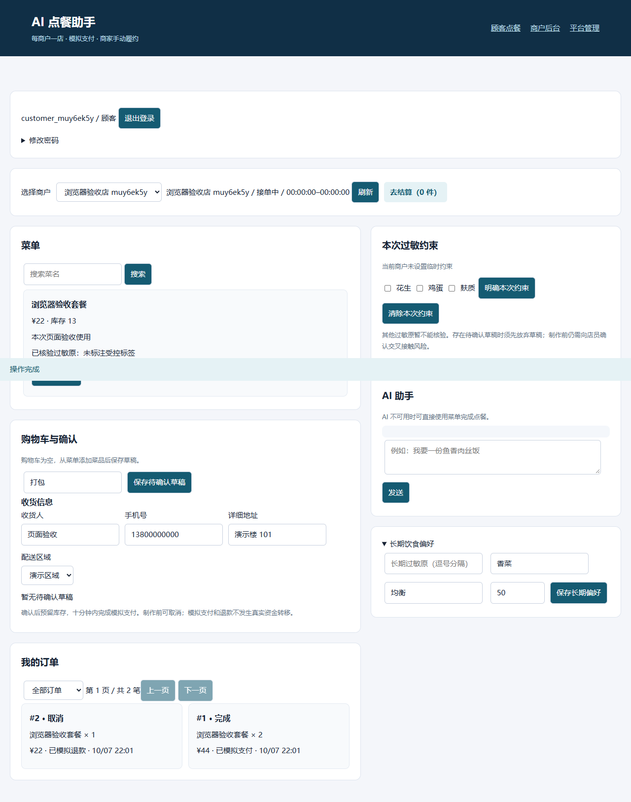
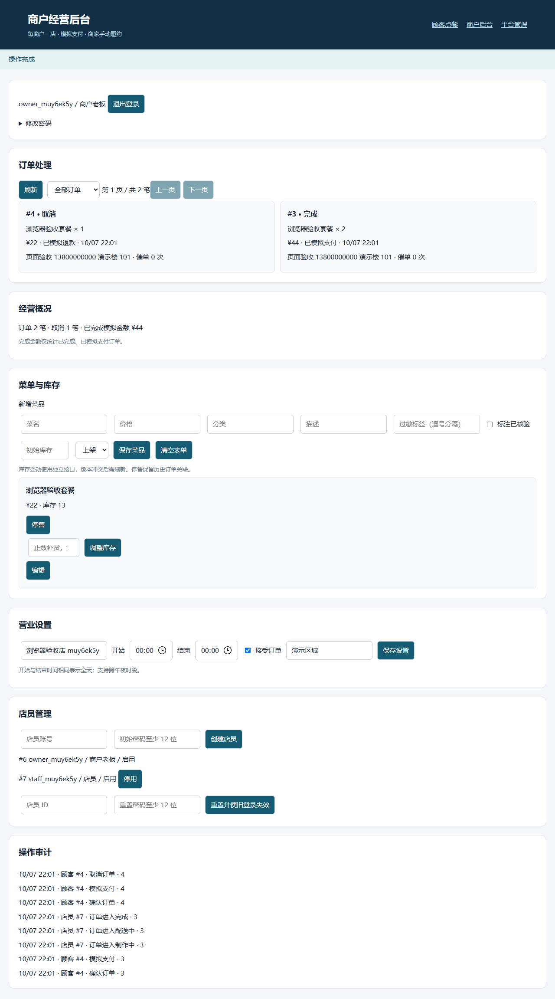
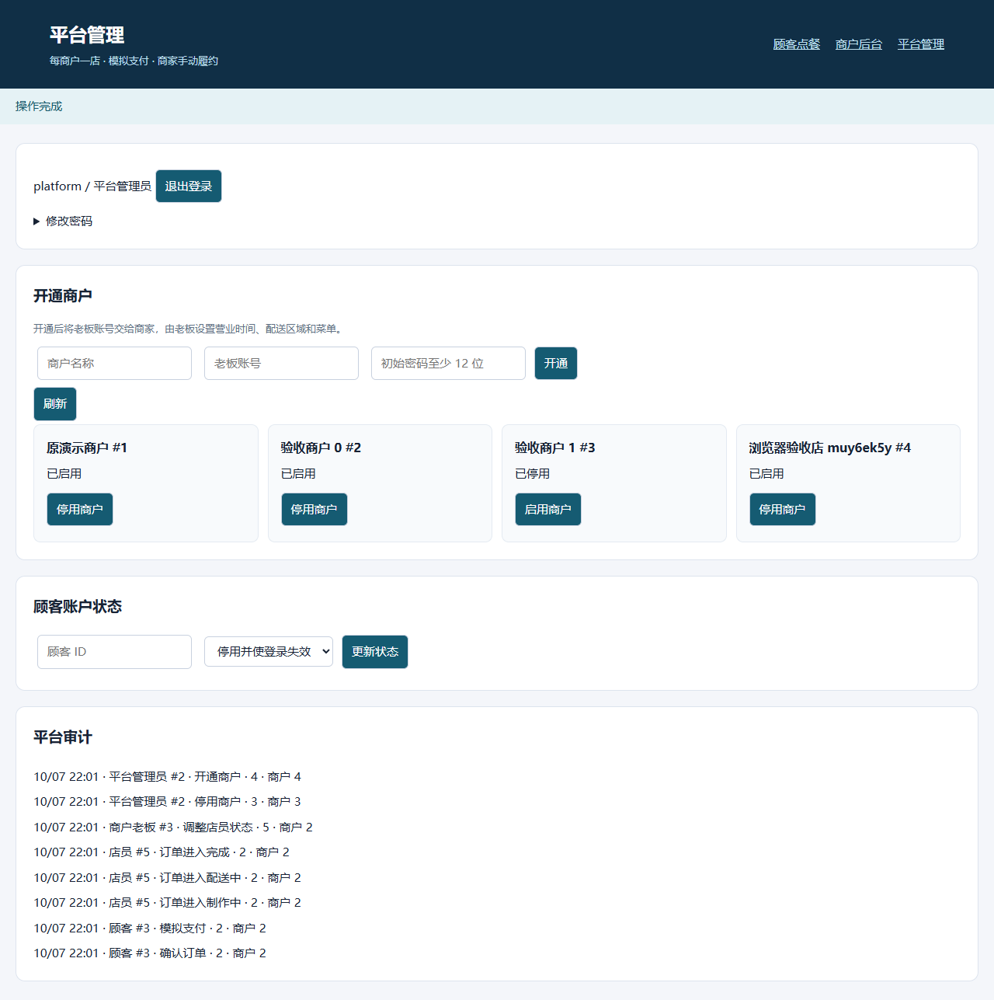

# 🍽️ AI 点餐助手：Java 业务后端 + Python Agent

[](https://github.com/W205614/AI-Order-Assistant/actions/workflows/ci.yml)
[](https://github.com/W205614/AI-Order-Assistant/actions/workflows/security.yml)

一个可本地部署的多商户 AI 点餐演示系统。平台开通商户，顾客选店后通过菜单或对话准备订单，商家处理制作与配送，并查看库存、统计和操作记录。每个商户对应一家店，支付与退款均为模拟记录。

Java 负责身份、权限、报价、库存和订单事务；Python 负责自然语言理解和工具编排。用户核对后点击确认才创建订单。未配置模型、模型断网或 Agent 停止时，菜单点餐、确认、模拟支付和订单操作仍可使用。

## ✨ 功能概览

- **顾客点餐**：选店、查看菜单、购物车、收货信息、草稿确认、模拟支付、取消退款和催单。
- **AI 辅助**：部分明确购物车指令由确定性 Router 处理，其余对话通过 LangGraph 调用模型与受限工具；符合条件的静态 FAQ 可直接检索回答。
- **安全约束**：菜单按长期过敏原和当前店铺临时约束过滤；草稿更新/确认还合并草稿快照。有过敏约束时，未核验或存在冲突的菜品禁止下单；约束尚未明确时阻止下单。
- **商户后台**：菜单上下架、独立库存调整、营业时间、配送区域、接单开关、员工管理、订单处理和经营统计。
- **平台管理**：开通与停用商户、停用顾客账号、查看平台审计；老板与店员权限分开。
- **交易保护**：草稿版本、报价复核、幂等确认、并发库存扣减、支付超时关闭及库存回补。
- **实时状态**：持久订单事件、SSE 通知、断线重连补读，顾客与商家页面同步订单进度。
- **部署与运维**：Docker Compose、Flyway 迁移、数据库备份与恢复演练、Prometheus 指标和 CI 验证。

## 📸 页面预览

以下截图来自 **2026-10-07 隔离浏览器验收**，展示测试账号与测试订单。它们用于说明页面布局；当前版本的验证结果见下方验收表。

**顾客端：菜单、购物车、偏好和订单**



<details>
<summary>商户后台：订单、菜单库存、店铺设置与员工管理</summary>



</details>

<details>
<summary>平台后台：商户开通、账号状态与审计</summary>



</details>

## 🏗️ 技术栈

| 部分 | 技术 | 职责 |
|---|---|---|
| 业务后端 | Java 21、Spring Boot 4.0.8、Spring Security、JDBC | 认证授权、菜单、草稿、交易、库存和审计 |
| Agent | Python 3.13、FastAPI、LangGraph、httpx、Pydantic | 对话编排、工具调用、截止时间与模型预算 |
| 前端 | HTML、CSS、原生 JavaScript 模块 | 顾客、商户和平台页面，移动端布局、SSE |
| 数据与缓存 | MySQL 8.4、Flyway、Redis 7.4 | 持久业务数据、迁移、聊天限流、额度和菜单元数据缓存 |
| 部署与监控 | Docker Compose、Prometheus；可选 Caddy | 六个默认服务、健康检查、指标、备份；公网 HTTPS 入口 |
| 验证 | JUnit、Testcontainers、Python unittest、Playwright、k6 | 数据库事务、接口与页面回归、隔离环境压测 |

Python 依赖由 [requirements.txt](agent-service/requirements.txt) 和 [requirements.lock.txt](agent-service/requirements.lock.txt) 固定；Java 依赖见 [pom.xml](java-gateway/pom.xml)。

## 🏛️ 架构与职责

```text
浏览器：顾客 / 商户 / 平台页面
   │ HttpOnly Cookie、CSRF、选店与业务请求
   ▼
Java Gateway
   ├─ AuthService / MerchantService             身份、角色与商户权限
   ├─ MenuService / DraftService                菜单、草稿、报价与版本
   ├─ OrderSafetyService                        统一合并偏好与过敏约束
   ├─ OrderTransactionService / InventoryService  交易、库存与补偿
   ├─ OrderQueryService / AuditService           查询与审计
   ├─ OrderStatusEventBroker                    持久事件与 SSE
   ├─ MySQL + Flyway                            业务事实与迁移
   └─ /chat：先处理过敏澄清/受约束推荐，其余请求固定用户、商户和截止时间
          ▼
      Python Agent
          ├─ 确定性购物车 Router / 静态 FAQ
          ├─ LangGraph / 模型工具白名单
          └─ 回调 Java：菜单、偏好、草稿、订单查询、催单及待确认取消

Redis：聊天限流、商户模型额度、菜单元数据缓存
运维：每日数据库备份 + Prometheus 指标与基础告警
```

控制器直接调用对应业务服务，事务由业务服务管理。Agent 工具参数不能改变网关传入的商户上下文；工具清单不含订单确认和模拟支付，取消已确认订单只生成待确认操作，页面点击后调用 Java。菜单与草稿/交易复用过敏原合并及校验逻辑，但菜单不读取草稿快照。

当前部署是单 Java 应用、单 Agent，多商户共享数据库并通过商户归属校验隔离。Agent 的进程内并发准入限制需要在增加副本前重新设计。

## 📁 项目目录

```text
AI-Order-Assistant/
├─ java-gateway/
│  ├─ src/main/java/com/ai/assistant/   控制器、业务服务、认证和 Agent 客户端
│  ├─ src/main/java/db/migration/      Java 数据迁移
│  ├─ src/main/resources/
│  │  ├─ db/migration/                 SQL 数据迁移
│  │  └─ static/                       chat / admin / platform / assets
│  └─ src/test/                        Java 与真实 MySQL 集成测试
├─ agent-service/
│  ├─ app/                             Agent、Java 回调、FAQ、预算和配置
│  ├─ tests/                           Python 规则与失败路径测试
│  └─ evals/                           检索与对话评测数据及脚本
├─ scripts/                            启动辅助、备份恢复、接口与浏览器验收
├─ deploy/                             备份、Prometheus、告警和 Caddy 配置
├─ load/                               k6 隔离压测场景
├─ docs/                               页面截图、运维说明和版本验收记录
├─ docker-compose*.yml                 基础、运维、隔离测试和公网配置
└─ start.ps1                           Windows 启动入口
```

## 🚀 快速启动

需要 Docker Desktop（Linux 容器）及支持 `!reset` / `!override` 的 Docker Compose v2。在 Windows 项目根目录运行：

```powershell
.\start.ps1 -Docker -Build
```

脚本生成本地 `.env`，保留已有密钥，先备份已有数据库，再配置业务数据库账号，启动网关、Agent、MySQL、Redis、备份和 Prometheus 六个服务并等待应用健康检查。

| 入口 | 地址 | 本地演示账号 |
|---|---|---|
| 顾客 | [点餐页面](http://localhost:9090/chat/) | `demo / 123456` |
| 商户 | [商户后台](http://localhost:9090/admin/) | `admin / admin123`（原演示店老板） |
| 平台 | [平台后台](http://localhost:9090/platform/) | 查看本地 `.env` 的 `PLATFORM_ADMIN_USERNAME` / `PLATFORM_ADMIN_PASSWORD` |
| 监控 | [Prometheus](http://localhost:19091/) | 仅绑定本机 |

演示种子默认开启，以上固定弱密码仅供本机演示。平台管理员密码随机生成；不要提交或分享 `.env`。

**模型配置可选**：不配置密钥也能菜单点餐；Agent 运行时，匹配 Router 的明确指令及符合首次消息、白名单等条件的静态 FAQ 不需要模型。需要一般自然语言推荐时，在 `.env` 设置 `LLM_API_KEY`、`LLM_BASE_URL`、`LLM_MODEL`，重新运行 `.\start.ps1 -Docker` 应用配置。

Linux 启动、已有数据库升级、公网 HTTPS 和完整配置说明见 [部署与运维指南](docs/operations.md)。

## 📝 使用流程

1. **开店**：平台开通商户和老板账号；老板设置营业时间、配送区域、菜单和库存，按需创建店员。
2. **点餐**：顾客登录选店，通过菜单或对话准备购物车；有过敏要求时先确认约束。
3. **核对**：点击“去结算”，保存草稿、填写收货信息并核对报价；价格变化会返回最新草稿，需重新确认。
4. **支付与履约**：确认后十分钟内点击“模拟支付”；商家依次推进制作、配送和完成。
5. **取消**：制作前可取消；已模拟支付时记录模拟退款并回补库存，重复取消不会再次回补。

## 🔧 核心实现

### 草稿、版本与幂等

每个用户在每家店最多保留一份活动草稿，创建和更新后五分钟有效，重新报价也刷新有效期。更新和确认提交 `expectedVersion`。确认时先复核可售状态、库存和过敏约束；这些检查通过后，若价格或菜品版本变化，返回 `409` 及重新报价的草稿，需再次确认。确认幂等键绑定用户、商户、草稿版本与收货信息，避免重复创建订单，也拒绝将同一键用于不同请求。

### 交易、库存与补偿

确认订单时在数据库事务内预留库存，支付超时和制作前取消会关闭订单并且只回补一次；已模拟支付的取消同时写入模拟退款记录。十分钟支付期限到达后拒绝支付，后台每十五秒扫描到期订单，关闭与回补可能晚于支付截止时间。独立库存接口使用版本、幂等键和流水，菜单编辑不会覆盖并发库存扣减。

```text
待模拟支付 → 商家待处理 → 制作中 → 配送中 → 完成
待模拟支付 → 十分钟未支付 → 支付超时关闭、回补库存
待模拟支付 / 商家待处理 → 顾客或商家取消、回补库存（已支付则模拟退款）
```

状态值为 `0` 待模拟支付、`1` 商家待处理、`2` 制作中、`3` 配送中、`4` 完成、`5` 取消、`6` 支付超时。经营金额仅统计状态 `4` 且支付状态为 `SIMULATED_PAID` 的订单。

### AI 工具与安全约束

Router 处理明确的点菜、增删菜品、单菜数量修改和备注等模式；菜名从当前可售菜单的首批最多 50 项中匹配，数量解析仅支持规定格式，不支持的表达转入模型路径。模型通过显式工具协议查询菜单、修改草稿或准备待确认操作。

长期偏好归用户，临时过敏约束归用户与商户。草稿创建保存临时过敏原快照，更新/确认时合并快照、当前临时约束和长期过敏原。花生、鸡蛋和麸质参与硬校验；不喜欢的食材、饮食目标及预算供推荐参考，不作为下单硬限制。后厨交叉接触仍需实际人工确认。

FAQ 使用关键词与标题二元字匹配，无向量数据库。只有无历史、无菜单勾选项的消息，高置信度命中静态白名单且未被指令/订单操作规则排除时，才直接返回答案；其余走模型路径。菜单、FAQ 和对话历史按不可信文本处理，可信身份与商户由网关及工具上下文控制；这不代表模型回答完全免疫提示注入。请求截止时间、提示大小、调用预算和每日商户额度共同限制模型调用；预算单位与提供商实际计费 token 分开记录。

### 故障降级与事件通知

超出 Agent 并发容量或聊天频率限制返回 `429 / AI_CAPACITY`；转发请求连接 Agent 超时、被拒绝或地址解析失败返回 `503 / AI_UNAVAILABLE`；响应读取超时或 Agent 返回 504 时映射为 `504 / AI_TIMEOUT`。提供商失败以及模型调用中的预算/额度耗尽通常返回 HTTP 200、`outcome=degraded` 和降级提示，不能统称为 429/504。顾客仍可使用普通菜单交易流程。

订单事件在事务内持久化，提交后尝试通过 SSE 推送，连接数与队列均有上限；断线重连按游标补读，实时推送失败不影响订单，页面列表作为最终状态依据。催单设置六十秒冷却，仅记录次数、时间和事件，不向真实商家发送外部消息。

## 🛡️ 认证与数据边界

浏览器使用 `HttpOnly` Cookie，不向页面返回 JWT，也不将凭证保存到 Web Storage；Cookie 写请求需要 `X-XSRF-TOKEN`。JWT 校验签发方、受众、有效期及账号状态和 token 版本；退出、改密码与停用账号使相应旧凭证失效。登录与注册同时受 CSRF 和数据库限流保护。

菜品、订单、草稿、库存、事件和审计由后端核验商户归属。老板管理本店菜单和员工，店员处理本店订单，平台管理员管理商户。公网部署还需关闭演示种子、更换弱密码并启用 HTTPS，详见 [安全部署要求](docs/operations.md#公网与认证)。

## 📚 接口与监控

| 范围 | 主要入口 |
|---|---|
| 认证与身份 | `/auth/*`、`/admin/login` |
| 菜单与约束 | `/merchants`、`/dish/list`、`/user/preferences`、`/order/safety-context` |
| 草稿与交易 | `/order/drafts`、`/order/drafts/{id}/confirm`、`/order/{seq}/pay`、`/order/{seq}/cancel` |
| 订单与通知 | `/order/list`、`/order/events`、`/order/events/replay` |
| 商户管理 | `/admin/dishes`、`/admin/orders`、`/admin/merchant`、`/admin/staff`、`/admin/stats`、`/admin/audit` |
| 平台管理 | `/platform/merchants`、`/platform/users/{id}/enabled`、`/platform/audit` |
| AI | 网关 `/chat`；Agent 接口仅供内部调用 |
| 健康与指标 | `/actuator/health/readiness`；网关指标支持内部密钥或平台管理员身份，Agent 指标需要内部密钥 |

浏览器业务写接口通过会话 Cookie 认证并携带 CSRF，登录/注册不要求已有身份；版本和幂等参数按具体接口要求提交。内部 Bearer 回调无会话 Cookie 时不要求 CSRF。具体请求契约见 [控制器源码](java-gateway/src/main/java/com/ai/assistant/controller)。

## ✅ 自动化验证与实测

基础验证命令如下。Java 集成测试需要 Docker；Python 需使用安装了固定依赖的 Python 3.13 环境。

```powershell
node scripts/check-static-js.mjs
Push-Location java-gateway
mvn clean test
Pop-Location
Push-Location agent-service
python -m unittest discover -s tests -v
python -m compileall -q app tests evals
Pop-Location
```

测试按边界分工：单元测试保护规则与错误分类，真实 MySQL/Flyway 测试保护事务、行锁和迁移，HTTP 测试保护认证及商户隔离，浏览器测试保护页面流程。保留这些不同职责的验证，不绑定提示词原文或评测集固定条数。

最近应用验收对应 **2026-10-11，提交 `d5794d2`**：

| 检查 | 实测结果 |
|---|---|
| Java | 55 项通过，其中真实 MySQL/Flyway 33 项，零跳过 |
| Python | 57 项通过，编译检查通过 |
| 前端与 Compose | 5 个 JS 模块语法、3 个页面内联脚本/事件处理器限制及 Compose 配置检查通过；不是完整 CSP 安全审计 |
| 重建后隔离环境 | 并发功能 15 个、角色/商户隔离 34 个、浏览器 23 个检查点通过，包含重复请求检查，不表示同等数量的独立测试场景 |
| 提供商故障 | 模拟 429、断连、超时三类通过 |
| 正式部署 | 27 个检查点通过；六个服务运行，网关/Agent/MySQL/Redis 健康；原用户/订单数量、商户数量和菜单库存基线检查通过，未逐字段比较所有数据 |
| 降级 | 停止 Agent 后，需转发的测试聊天请求返回 503，普通点餐、支付、取消退款可用 |

镜像、备份校验、清理范围和验证边界见 [重构与部署验收](docs/verification/2026-10-11/重构与部署验收.md) 与 [机器可读结果](docs/verification/2026-10-11/results.json)。该应用提交的 [功能 CI](https://github.com/W205614/AI-Order-Assistant/actions/runs/38118556721) 和 [安全扫描](https://github.com/W205614/AI-Order-Assistant/actions/runs/38118556742) 均通过，最新提交状态见顶部徽章。

本轮应用重构未运行压测或付费真实模型评测。[2026-10-07 验收报告](docs/verification/2026-10-07/验收报告.md) 保留历史浏览器、恢复与压测证据，其中性能数字仅对应当时机器和场景。[2026-10-09 状态码修复](docs/verification/2026-10-09/状态码修复验证.md) 记录 503/504 回归。隔离容器验收、可选压测命令见 [验证指南](docs/operations.md#验证与压测)。

## 💾 备份与恢复

启动升级前备份，运行后每日备份，通常保留最近七份，未通过校验的旧备份不自动删除。恢复脚本在独立临时 MySQL 中核验 SHA-256、恢复导入和订单明细归属，并记录订单/库存等指纹；只有传入 `-SourceProject` 才与源库指纹比较，不覆盖正式库。这不是全库逐字段一致性验证。

```powershell
.\scripts\backup-db.ps1
.\scripts\restore-db.ps1 -BackupFile .\backups\orders-时间戳.sql
```

本地配置和备份均被 Git 忽略。不要对业务数据卷运行 `docker compose down -v` 或全局清理；旧应用镜像删除前先归档、校验，并核实其他容器引用。跨版本回滚需配套数据库备份，操作见 [备份与清理指南](docs/operations.md#备份恢复与清理)。

## ❓ 使用边界

- **没有模型密钥**：普通点餐可用；Agent 运行时部分明确购物车指令和首次静态 FAQ 可直接处理。一般模型推荐需要兼容接口。Agent 停止时，需要转发的对话失败，Java 本地的过敏澄清和受约束菜单推荐仍可返回。
- **公网部署**：提供可选 Caddy 配置，本机验收没有验证实际域名的证书签发与公网 TLS。
- **交易范围**：支付和退款为模拟；真实支付、平台结算、骑手调度、优惠券、自动入驻和多门店尚未实现。
- **运行规模**：当前是单应用/单 Agent 演示部署；备份位于同机，外部告警通知尚未配置，需要另存异机备份。

## 🤝 开发约定

业务事实和事务规则放在 Java 服务中；Python 使用显式工具协议和普通辅助函数，保持流程容易阅读。新增测试应保护行为和边界；改动数据库需提供 Flyway 迁移，不能通过放宽断言掩盖失败。提交前完成受影响的验证，配置、凭证、原始敏感日志及本地测试数据不入库。
