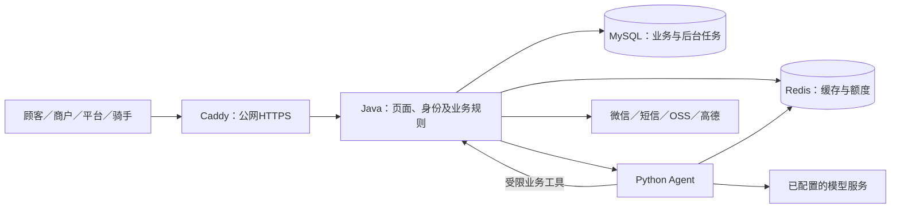
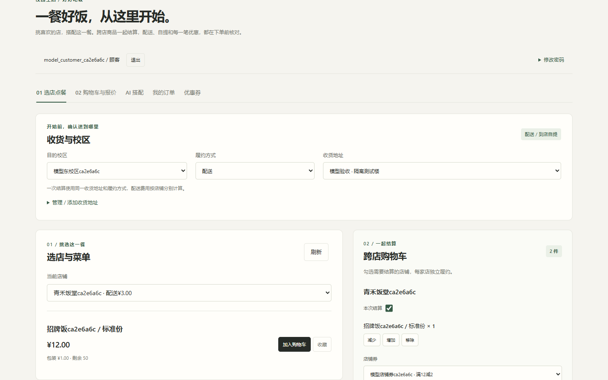
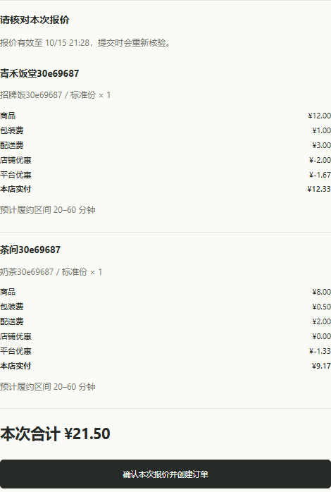
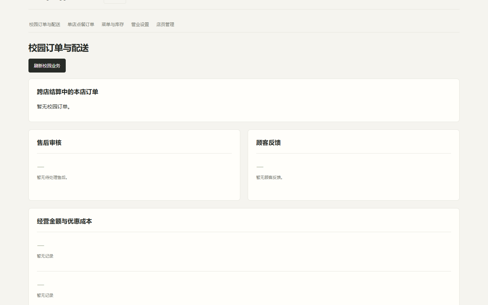
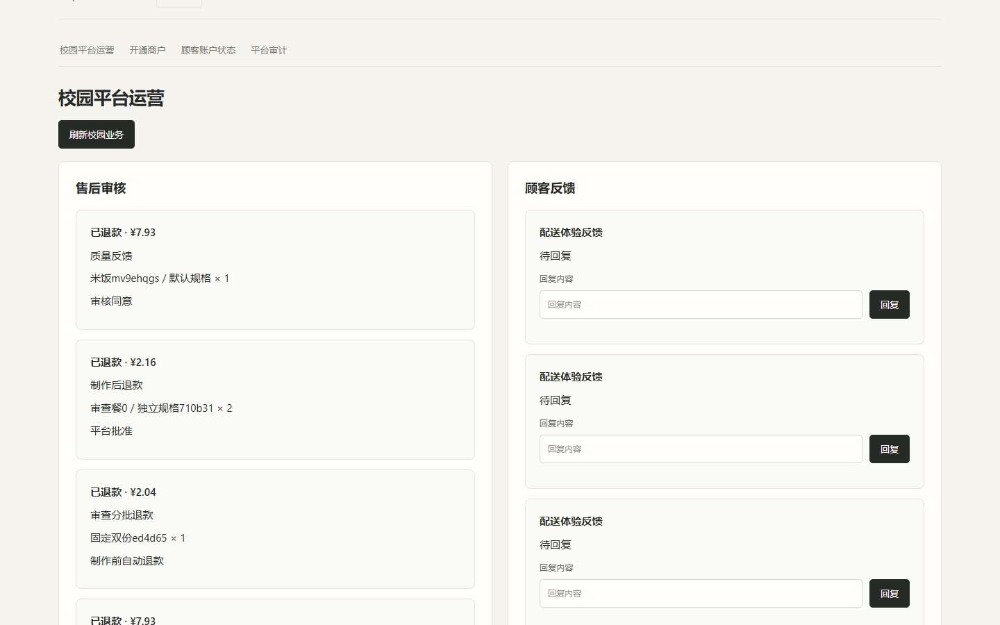

# AI 点餐助手

[](https://github.com/W205614/AI-Order-Assistant/actions/workflows/ci.yml)
[](https://github.com/W205614/AI-Order-Assistant/actions/workflows/security.yml)

一个支持本地演示及指定外部服务接入的校园多店点餐系统。顾客可以直接选菜，也可以让 AI 按口味和预算推荐、准备跨店购物车；核对报价后统一结算，再由各店独立备餐、配送或自提。

项目采用 **Java 业务后端 + Python Agent**：Java 核验权限、价格、库存和订单，AI 负责理解需求与调用工具。创建订单和支付都需要顾客在页面确认。**默认本地支付、退款为模拟，不涉及真实资金；真实渠道必须按接入指南配置并完成账号验收。**

[快速开始](#快速开始) · [体验第一笔订单](#体验第一笔订单) · [核心能力](#核心能力) · [上线准入](docs/production-readiness.md) · [更多文档](#更多文档)

## 核心能力

| 场景 | 已实现能力 |
|---|---|
| 顾客点餐 | 跨店购物车、服务端报价、商品及优惠分摊、预约、配送／自提、取消与售后 |
| 商户与配送 | 本店接单备餐、规格库存、店员权限、骑手抢单、送达核验、异常与人工改派 |
| 资金与通知 | 本地模拟或微信服务商合单、异步退款、查单与对账、站内通知及可选短信 |
| 账号与媒体 | 验证手机号、密码找回、菜品／店铺图片、按订单权限访问售后凭证 |
| AI协助 | 按口味和预算搜索、准备购物车、查询本人订单；创建、取消和支付由本人确认 |

工程实现及本地验证已完成当前校园试运营范围；真实服务接入、正式发布与生产恢复验收仍须逐项通过 [上线准入](docs/production-readiness.md)。默认演示环境与真实资金环境分别记录，README的CI徽章仅表示远端对应提交的结果。

## 快速开始

### 1. 准备环境

- 安装 Git、Docker 和 Docker Compose。Windows 推荐使用 Docker Desktop，并切换到 Linux 容器。
- 启动 Docker，确保本机 `9090`（应用）和 `19091`（监控）端口未被占用。
- 首次构建需要联网下载镜像与依赖；使用 Docker 部署无需在本机安装 Java、Python 或 MySQL。

### 2. 下载并启动

以下命令用于全新部署。已有数据库请先阅读[升级步骤](docs/operations.md#启动与配置)和[备份策略](docs/operations.md#备份恢复与清理)。

在 Windows PowerShell 中运行：

```powershell
git clone https://github.com/W205614/AI-Order-Assistant.git
cd AI-Order-Assistant
$env:APP_REVISION = git rev-parse HEAD
.\start.ps1 -Build
```

看到 `Ready: http://localhost:9090/` 后，打开[校园点餐页面](http://localhost:9090/campus/)。全新演示库使用顾客账号 `demo`，密码在项目根目录 `.env` 的 `DEMO_CUSTOMER_PASSWORD`。无需模型密钥即可选菜、报价、下单和模拟支付。

如果 PowerShell 提示禁止运行脚本，可仅对本次启动使用：

```powershell
powershell -NoProfile -ExecutionPolicy Bypass -File .\start.ps1 -Build
```

<details>
<summary>Linux / macOS：全新部署</summary>

```bash
git clone https://github.com/W205614/AI-Order-Assistant.git
cd AI-Order-Assistant
cp .env.example .env
# 先按下方说明编辑 .env，再启动
APP_REVISION="$(git rev-parse HEAD)" docker compose -p ai-order-assistant -f docker-compose.yml up --build -d --wait
```

启动前，将 `.env` 中的数据库、Redis、平台及演示账号密码和认证密钥全部替换为各自独立的随机值。账号密码至少 12 位，认证密钥至少 32 字符；完整名称见 [.env.example](.env.example)。保留 `DEMO_SEED_ENABLED=true` 以体验演示数据，模型密钥可留空。数据库结构由一次性 `migrate` 服务更新，成功退出后才启动网关；五个日常服务持续运行。

以上流程用于全新数据库；已有数据升级请先阅读 [部署与运维指南](docs/operations.md#启动与配置)。

</details>

### 3. 选择入口并登录

| 角色 | 访问地址 | 本地演示账号 |
|---|---|---|
| 顾客（推荐从这里开始） | [校园点餐](http://localhost:9090/campus/) | `demo`，密码见本地 `.env` 的 `DEMO_CUSTOMER_PASSWORD`；也可在页面注册 |
| 商家 | [商户后台](http://localhost:9090/admin/) | `admin`，密码见本地 `.env` 的 `DEMO_OWNER_PASSWORD` |
| 店员 | [商户后台](http://localhost:9090/admin/) | 由店主创建；处理本店订单，不能修改菜单、库存和配送配置 |
| 平台管理员 | [平台后台](http://localhost:9090/platform/) | 查看本地 `.env` 中的 `PLATFORM_ADMIN_USERNAME` 和 `PLATFORM_ADMIN_PASSWORD` |
| 骑手 | [骑手任务](http://localhost:9090/rider/) | 由平台创建账号并授权服务校区 |
| 原单店顾客 | [单店助手](http://localhost:9090/chat/) | 与校园顾客共用账号 |

全新部署默认提供“默认校区”、一家演示店及菜单，可先完成单店点餐。**默认启动不会生成完整多角色场景**；想直接展示跨店、优惠和配送，使用下方独立演示命令。自行配置时，先在平台后台开通更多商户，再由商家配置商品和服务校区；跨校区服务需要明确开启。

上述账号适用于开启演示种子的全新数据库；已有数据库或关闭种子时可能不存在。Windows 启动脚本生成独立随机密码；升级迁移会替换仍使用旧公开弱密码的演示账号并失效其旧会话，已自行改为其他密码的账号保持原密码。`.env` 包含私密配置，请勿提交或分享。公网部署前请按 [安全部署说明](docs/operations.md#公网与认证) 关闭演示种子并启用 HTTPS。

## 体验第一笔订单

建议先使用**到店自提**走完流程，之后再体验配送和骑手功能：

1. 在 [校园点餐](http://localhost:9090/campus/) 用演示顾客登录，选择“默认校区”，将履约方式设为“到店自提”，选择演示店。若使用配送，先展开“管理 / 添加收货地址”，保存并选择当前校区的地址。
2. 从菜单加入商品；有过敏需求时，先勾选具体过敏原并点击“确认本店过敏约束”。跨店需逐店确认，未保存的选择会阻止继续加购和报价。
3. 在购物车勾选需要结算的店铺，点击“计算所选店铺报价”，核对商品、费用和优惠，再点击“确认本次报价并创建订单”。首次体验可以不使用优惠券或预约。
4. 在“我的订单”中点击“统一模拟支付”，需在创建订单后十分钟内完成。
5. 用另一个浏览器或无痕窗口打开 [商户后台](http://localhost:9090/admin/)，进入“校园订单与配送”，在“跨店结算中的本店订单”依次点击“确认接单 → 开始制作 → 备餐完成”。未看到新订单时点击“刷新校园业务”。
6. 顾客在订单中点击“查看本人取餐码”，商家输入该码并点击“核验自提”；回到顾客页查看完成状态。

## 项目结构

| 目录 | 去哪里找什么 |
|---|---|
| `java-gateway/` | 业务接口、交易规则、静态页面、数据库迁移和 Java 测试 |
| `agent-service/` | Python Agent 编排、工具、FAQ、单元测试和模型评测 |
| `deploy/` | Compose 场景覆盖、代理、监控和备份配置 |
| `scripts/` | 启动辅助、巡检与系统验证，按[脚本索引](scripts/README.md)选择 |
| `load/` | k6 压测场景 |
| `docs/` | 业务说明、运维、截图与验收记录 |
| `.github/` | CI、安全扫描、依赖更新与手动模型评测 |

Java 使用 Spring Boot 和 Spring Security，Python 使用 FastAPI 和 LangGraph，数据存储使用 MySQL 和 Redis。前端为 Java 直接提供的原生 HTML、CSS 和 JavaScript。



本地模式直接访问Java；公网模式由Caddy提供入口。外部能力按配置启用，Agent不直接操作业务数据库。持久化后台任务和第三方网络调用的边界见 [项目结构](docs/project-structure.md)。

从页面的“计算所选店铺报价”跟到 Java 结算事务，可沿着[项目结构与阅读顺序](docs/project-structure.md#java从页面到交易)逐步阅读。

## 可选体验

### 开启 AI 对话（可选）

**不配置模型也能完成菜单点餐、报价、下单和模拟支付。** 校园页的“按预算查找组合”同样不依赖模型；自然语言对话需要模型服务。

编辑项目根目录的 `.env`，填写兼容当前 Agent 的模型服务配置：

```dotenv
LLM_API_KEY=你的模型密钥
LLM_BASE_URL=模型服务的 API 基础地址
LLM_MODEL=模型名称
```

三个值应对应同一模型服务。保存后，在 Windows 重新运行 `.\start.ps1`；Linux / macOS 重新运行上面的 Compose 启动命令即可应用配置。调用模型可能产生提供商费用。

### 一次准备完整多角色演示（可选）

```powershell
.\scripts\start-demo.ps1 -Build
```

打开 [独立校园演示](http://127.0.0.1:19092/campus/)。脚本启动独立的 `ai-order-demo` 项目及数据卷，新增两个校区、两家店、顾客、两位店主、店员、两位骑手、店铺券与平台券、配送规则和预约时段。日常 `9090` 环境保留，演示环境默认不调用付费模型。

角色账号和密码保存在本机 `.local/demo/manifest.json`，平台账号在 `.local/demo/.env`，均不会提交 Git。按顾客、店主/店员、平台、骑手分别使用独立浏览器配置或窗口；管理端账号在同一浏览器配置内共用会话，请勿靠普通新标签页隔离角色。

选择名称包含“演示东校区”的校区，从演示饭堂和饮品店加购，领取优惠、核对报价，再亲自确认订单和模拟支付。随后由商家备餐、骑手抢单及核验送达；上方第一笔订单流程也可用于该环境，将端口改为 `19092` 并使用生成的账号。

再次运行该命令会复用场景，保留人工修改，不预造订单或支付。初始优惠有效 30 天，预约在初始化 15 分钟后截止；重新运行不会替换已过期或手动修改的数据，可在后台自行新增。已有清单而私有配置丢失时脚本拒绝重置，请保管两份文件。

### 继续体验配送与角色协作

1. 店主在“所属校区与跨校区配送”选择目的校区，核对配送费、起送金额和预计分钟数，再勾选开放并保存。切换校区会回填已保存规则；未配置校区默认不开放，保存后保留当前面板和校区选择。
2. 平台在“平台骑手”创建账号并勾选服务校区；店主可在店员管理中创建店员，用独立窗口登录商户后台体验接单与备餐。
3. 顾客使用配送方式下单并模拟支付，店主或店员备餐完成后，骑手可在任务池抢单、确认取餐，并用顾客提供的送达码核验完成。错误码会显示原因，允许核对后重新输入。
4. 骑手遇到问题可填写原因并“报告异常”。平台点击开通商户区的“刷新”或“刷新校园业务”，在“配送任务与改派”核对店内订单、店铺、目的校区和异常说明，再指定接续骑手。取餐后的任务不能释放回任务池。

## 试运营与外部服务接入

已选定的接入方向为微信服务商合单支付（Native/H5/JSAPI）、阿里云短信和 OSS、高德地址与骑行路线，以及外部 MySQL/Redis。各店独立收款，本轮不抽佣；平台券作为参与商户承担折扣的联合活动。

从 [服务接入指南](docs/integrations.md) 开始，按 [配置模板](deploy/integrations.env.example) 准备身份、资质、域名、权限和云资源。指南包含逐项配置、回调、启用命令、失败处理，以及告警、异地备份和固定镜像发布／回滚步骤。`python scripts/check-integrations.py --env-file .env` 可进行不发短信、不扣款、不调用模型的预检查。

**工程实现、本地契约验证与生产实联分别记录。** 本轮已实现上述指定服务的适配、迁移、页面及运维入口，详见[实现验收](docs/verification/2026-11-06.md)及[整改、全量回归与日常部署收尾](docs/verification/2026-11-06-production-closeout.md)。真实支付、短信、OSS、高德及云资源尚未生产实联；后续准备资质、账号、权限、密钥和资源，按指南配置并运行 `scripts/verify-live-integrations.py` 等验收命令。配置检查通过不等于真实资金流程已验证。

## 稳定性与日常维护

在项目根目录运行 `.\scripts\check-operations.ps1` 可检查服务和备份状态。巡检参数、备份停用标记、恢复步骤和公网检查见[部署与运维指南](docs/operations.md)。

## 页面预览

以下为已有验收截图，使用演示账号和专门准备的场景数据；首次部署的商品、优惠和金额可能不同。

**顾客端：选店、菜单与跨店购物车**



<details>
<summary>展开查看：跨店报价、商户后台与平台后台</summary>

**报价明细：逐店核对商品、费用与优惠**



**商户后台：本店订单、售后与经营统计**



**平台后台：售后审核与顾客反馈**



</details>

## 常见问题

- **打不开页面或启动未完成？** 确认 Docker 已启动、端口未被占用，再在项目根目录查看服务状态和日志：

  ```powershell
  docker compose -p ai-order-assistant -f docker-compose.yml ps
  docker compose -p ai-order-assistant -f docker-compose.yml logs --tail 100 gateway agent
  ```

- **没有店铺、商品或无法报价？** 全新部署先选“默认校区”。自建店铺需启用接单、处于营业时间、有可售库存，并开放目的校区服务；配送还需选择地址。报价提示店铺不可提交时，按页面原因调整后重新报价。
- **AI 没有响应或提示不可用？** 检查模型配置是否已应用，并查看 Agent 日志；可继续使用普通菜单、购物车和结算流程。
- **修改后如何重新启动？** 仅修改 `.env` 时运行 `.\start.ps1`；提交或拉取代码后，先运行 `$env:APP_REVISION = git rev-parse HEAD`，再运行 `.\start.ps1 -Build`，以当前提交标记镜像，避免沿用 `.env` 中的旧版本号。版本标记不能代替源码与运行内容核验，升级与备份细节见 [运维指南](docs/operations.md)。
- **如何停止并保留数据？** 在根目录运行 `docker compose -p ai-order-assistant -f docker-compose.yml stop`。数据库保存在 Docker 数据卷中；不要用 `down -v` 清理业务数据。Windows 下次可运行 `.\start.ps1` 启动，Linux / macOS 使用上面的 Compose 启动命令。

## 更多文档

- [项目结构与阅读顺序](docs/project-structure.md)：目录职责、前后端入口和一笔订单的调用链。
- [校园业务说明](docs/campus-commerce.md)：跨店结算、优惠退款、预约履约及 AI 工具的详细规则。
- [部署与运维指南](docs/operations.md)：完整配置、Linux 部署、升级、HTTPS、备份恢复与监控。默认监控入口为 [Prometheus](http://localhost:19091/)。
- [试运营服务接入指南](docs/integrations.md)：微信合单、短信找回、图片、地图、云数据、告警投递、异地备份及发布回滚。
- [上线准入与运行边界](docs/production-readiness.md)：发布、真实渠道、恢复验收和运营责任的完成条件。
- [开发与协作](CONTRIBUTING.md)：本地环境、修改边界、必要检查与提交材料。
- [安全说明](SECURITY.md)：敏感问题报告、支持边界及生产安全责任。
- [本轮整改与部署收尾](docs/verification/2026-11-06-production-closeout.md)：完整回归、CI证据、V9日常升级、资源清理及最终状态。
- [历史验收入口](docs/history.md)：通过固定提交查阅归档报告；远端回归状态查看对应提交的 GitHub Actions。
- [本轮试运营补全验收](docs/verification/2026-11-06.md)：支付退款、账号图片通知、云配置、告警、标准镜像、安全扫描与生产接入边界。
- [此前依赖维护验收](docs/verification/2026-11-05.md)：Dependabot 路径修复、依赖合并、标准构建、售后与反馈及 AI 回归、本地数据核对。
- [此前售后与 AI 核对验收](docs/verification/2026-10-31.md)：分页与购物车核对的原始修改、当时的包源限制及清理停止记录。
- [此前架构与稳定性优化](docs/verification/2026-10-28.md)：履约分页与隐私、聊天准入、备份超时、响应边界、前端拆分及当轮镜像扫描。
- [此前校招演示与稳定性验收](docs/verification/2026-10-21.md)：修改依据、五角色体验、模型预算、备份恢复和交付边界。

默认启动仍面向本地演示。真实服务以接入配置和本轮验收记录为准；自动派单、平台抽佣及骑手资金结算不在当前范围。过敏规则校验不能替代商家对实际食材及后厨交叉接触的确认。

仓库尚未声明项目级`LICENSE`，本次文档补全不替权利人选择授权条款。第三方SDK和二维码实现保留各自许可，见 [接入指南](docs/integrations.md) 与 [vendor说明](java-gateway/src/main/resources/static/assets/vendor/README.md)。
